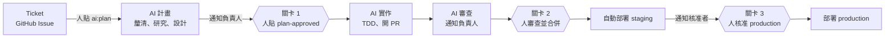

# ai-dev-pipeline — 從 Ticket 到上線的 AI 開發流水線

讓 AI Agent（Claude Code）負責需求釐清、研究、設計、實作與 Code Review；人只在三個關卡介入：
**計畫是否執行、PR 是否合併、是否放行正式環境部署**。需要人的時候，自動在 Slack 或 Teams 通知並
@負責人。為 10~20 人的團隊設計，**不需要自架任何伺服器**，全部跑在 GitHub Actions。

> 狀態：v0.1.0。腳本與 workflow 邏輯有近百個自動化測試；但**尚未在真實 GitHub 組織做過端到端驗證**。
> 請先照 [§驗證](#12-驗證冒煙測試) 在練習用 repo 跑一遍，並閱讀
> [設計文件 §14](docs/architecture/DESIGN.md) 的未驗證項目。

## 目錄

1. [它怎麼運作](#1-它怎麼運作)
2. [前置需求](#2-前置需求)
3. [取得本專案並自我檢查](#3-取得本專案並自我檢查)
4. [準備練習用 repo](#4-準備練習用-repo)
5. [取得 Anthropic API Key](#5-取得-anthropic-api-key)
6. [安裝 Claude GitHub App](#6-安裝-claude-github-app)
7. [把 pipeline 安裝進你的 repo](#7-把-pipeline-安裝進你的-repo)
8. [設定 Secrets 與 Variables](#8-設定-secrets-與-variables)
9. [建立標籤](#9-建立標籤)
10. [設定通知（Slack / Teams）](#10-設定通知slack--teams)
11. [設定三個人工關卡](#11-設定三個人工關卡)
12. [驗證（冒煙測試）](#12-驗證冒煙測試)
13. [日常使用](#13-日常使用)
14. [推廣到團隊與正式專案](#14-推廣到團隊與正式專案)
15. [設定參考](#15-設定參考)
16. [疑難排解](#16-疑難排解)
17. [專案結構與開發本工具](#17-專案結構與開發本工具)
18. [安全注意事項、限制與路線圖](#18-安全注意事項限制與路線圖)
19. [文件索引](#19-文件索引)

---

## 1. 它怎麼運作



| 階段 | 誰做 | 觸發 | 結果 |
| --- | --- | --- | --- |
| 需求釐清、研究、設計 | AI（唯讀） | 人貼標籤 `ai:plan` | issue 留言「AI 需求釐清」或「AI Plan」 |
| **關卡 1：計畫** | **人** | 人貼標籤 `plan-approved` | 啟動實作 |
| 實作、測試 | AI | `plan-approved` | 開 PR（`Closes #N`） |
| Code Review | AI（唯讀） | PR 開啟或更新 | inline 留言與摘要 |
| **關卡 2：合併** | **人** | 人審查並按 Merge | 由分支保護強制 |
| 部署 staging | CI/CD | push 到 `main` | 自動 |
| **關卡 3：正式環境** | **人** | Environment 審核 | 由 GitHub 暫停 job |

三個關卡都由 **GitHub 平台功能**強制（標籤權限、Ruleset、Environment 審核者），AI 無法繞過。
完整設計見 [設計文件](docs/architecture/DESIGN.md)。

## 2. 前置需求

| 項目 | 需要 | 檢查指令 |
| --- | --- | --- |
| GitHub | 帳號，且對目標 repo 有 **Admin** 權限（要設定 secrets、分支保護） | — |
| Anthropic | 一個 API Key（需要有額度） | — |
| 你的電腦 | bash 4 以上、git、jq、curl、python3 | `bash --version`、`git --version`、`jq --version` |
| GitHub CLI | `gh`，並已登入 | `gh auth status`（未登入先執行 `gh auth login`） |
| 通知（可選） | Slack 或 Teams 的頻道管理權限 | — |

macOS 內建的 bash 是 3.2，請先 `brew install bash`，並用新版執行腳本。Windows 請使用 WSL 或 Git Bash。

## 3. 取得本專案並自我檢查

```bash
git clone <本專案的網址> ai-dev-pipeline
cd ai-dev-pipeline
```

（如果你拿到的是壓縮檔，解壓縮後 `cd` 進去即可。）

跑一次自我檢查，確認你的電腦環境沒問題：

```bash
pip install pyyaml        # 測試需要；已安裝可略過
make test                 # 應該顯示 "passed: N  failed: 0"
```

`make lint` 與 `make docs-check` 是選用的（需要 `shellcheck`、`yamllint`、`actionlint`）。

## 4. 準備練習用 repo

**第一次請務必用練習用 repo**，不要直接裝進正式專案。

1. 在 GitHub 按 `+` → `New repository`，名稱例如 `ai-pipeline-sandbox`，選 **Private**，勾選
   `Add a README file`。
2. 放一個**很小、有測試**的專案進去（AI 需要能跑測試）。沒有現成的，可用最小的 Node 範例：

   ```bash
   gh repo clone <你的帳號>/ai-pipeline-sandbox && cd ai-pipeline-sandbox
   npm init -y
   mkdir src test
   cat > src/greet.js <<'EOF'
   exports.greet = (name) => `Hello, ${name}!`;
   EOF
   cat > test/greet.test.js <<'EOF'
   const test = require('node:test');
   const assert = require('node:assert');
   const { greet } = require('../src/greet');
   test('should_greet_by_name_when_name_is_given', () => {
     assert.strictEqual(greet('Ada'), 'Hello, Ada!');
   });
   EOF
   npm pkg set scripts.test="node --test" scripts.lint="node --check src/greet.js"
   git add -A && git commit -m "chore: add tiny sample project" && git push
   ```

   Python、Go、Java 專案也可以，指令不同而已（見 [客製化指南](docs/guides/customizing.md)）。

## 5. 取得 Anthropic API Key

1. 登入 [platform.claude.com](https://platform.claude.com)，儲值少量額度（練習用 5 美元左右就夠）。
2. 到 API keys 建立一把**這個 pipeline 專用**的 Key，並複製。Key 只會顯示一次。
3. **設定這把 Key（或其所在 workspace）的用量上限**，避免意外花費。
4. 團隊使用請用 API Key，不要用個人訂閱的 OAuth token（理由見
   [ADR-0005](docs/adr/0005-authentication-api-key-at-organization-level.md)）。

## 6. 安裝 Claude GitHub App

1. 打開 [github.com/apps/claude](https://github.com/apps/claude)，按 `Install`。
2. 選你的帳號或組織；`Only select repositories` → 勾選練習用 repo → `Install`。
3. 這個 App 會要求不少權限，這是官方 App 固定的權限組合，無法只選一部分。若你的組織要求最小權限，
   請改用自訂 GitHub App（見 [Claude Code 官方文件](https://code.claude.com/docs/en/github-actions)）。

## 7. 把 pipeline 安裝進你的 repo

在**練習用 repo 的資料夾**中操作（下面假設兩個資料夾並排放）：

```
~/work/
├── ai-dev-pipeline/        ← 本專案
└── ai-pipeline-sandbox/    ← 你的 repo
```

```bash
cd ~/work/ai-pipeline-sandbox
git checkout -b chore/install-ai-pipeline

# 1) 先預覽會複製哪些檔案（不會改動任何東西）
bash ../ai-dev-pipeline/tools/scripts/install-into.sh --dry-run .

# 2) 實際安裝（已存在的檔案會被跳過，不會覆蓋）
bash ../ai-dev-pipeline/tools/scripts/install-into.sh .
```

安裝了什麼：

| 位置 | 內容 |
| --- | --- |
| `.github/workflows/` | `ai-plan.yml`、`ai-implement.yml`、`ai-review.yml`、`claude.yml`、`deploy.yml` |
| `.github/` | `notify-owners.json`、`ISSUE_TEMPLATE/`、`PULL_REQUEST_TEMPLATE.md`、`CODEOWNERS`、`dependabot.yml` |
| `.claude/` | `settings.json`、hooks（擋機密、保護規則檔）、skills、`rules/` |
| `tools/prompts/` | 三個階段的提示詞 |
| `tools/scripts/` | `notify.sh`、`scan-secrets.sh`、`check-memory-links.sh`、`setup-labels.sh` |
| 根目錄 | `CLAUDE.md`、`todo.md`、`CHANGELOG.md`、`.agents/`、`docs/adr/0000-template.md` |

若 repo 已有 `CLAUDE.md`，安裝器**不會覆蓋**，而是另存 `CLAUDE.pipeline.md`，請手動合併。
要覆蓋某些檔案時才加 `--force`。

接著完成以下**必要的客製化**：

1. 編輯 `CLAUDE.md`，把所有 `FIXME(setup)` 填好（專案說明、安裝／測試／lint／建置指令）。
2. 編輯 `.github/notify-owners.json`，換成你團隊的資料（見 [§10](#10-設定通知slack--teams)）。
3. 編輯 `.github/CODEOWNERS`，換成真實的人或團隊並取消註解。
4. `deploy.yml` 預設不會執行；要部署時再改（見 [客製化指南 §5](docs/guides/customizing.md)）。

提交、推送並合併：

```bash
git add -A
git commit -m "chore: install ai-dev-pipeline"
git push -u origin chore/install-ai-pipeline
gh pr create --fill
gh pr merge --squash     # 或在網頁上按 Merge
```

**一定要合併到預設分支（`main`）**：以 issue 標籤觸發的 workflow 只會從預設分支載入。

## 8. 設定 Secrets 與 Variables

### 方法 A：網頁

repo 的 `Settings` → `Secrets and variables` → `Actions`。

- `Secrets` 分頁 → `New repository secret`：
  - `ANTHROPIC_API_KEY`：第 5 步的 Key（名稱一個字都不能錯）
  - `SLACK_WEBHOOK_URL` 和／或 `TEAMS_WEBHOOK_URL`（第 10 步取得）
- `Variables` 分頁 → `New repository variable`（以 Node 專案為例）：
  - `AI_SETUP_CMD` = `npm ci`
  - `AI_TEST_TOOLS` = `Bash(npm test:*),Bash(npm run lint:*)`

### 方法 B：指令

```bash
REPO=<你的帳號>/ai-pipeline-sandbox
gh secret set ANTHROPIC_API_KEY --repo "$REPO"          # 會提示你貼上 Key（不會顯示在畫面）
gh variable set AI_SETUP_CMD  --repo "$REPO" --body 'npm ci'
gh variable set AI_TEST_TOOLS --repo "$REPO" --body 'Bash(npm test:*),Bash(npm run lint:*)'
```

其他語言的值、模型選擇等見 [客製化指南](docs/guides/customizing.md)。

## 9. 建立標籤

流程靠標籤驅動；標籤不存在時 AI 貼不上去。在**本專案資料夾**或任何已安裝的 repo 內執行：

```bash
bash tools/scripts/setup-labels.sh --repo <你的帳號>/ai-pipeline-sandbox
```

會建立（可重複執行）：`ai:plan`、`needs:clarification`、`needs:plan-approval`、`plan-approved`。

## 10. 設定通知（Slack / Teams）

只想先試流程可以先跳過，但沒有通知就不會有人被叫醒。最簡版：

1. 依 [Slack／Teams 設定指南](docs/guides/slack-teams-setup.md) 取得 webhook URL，存成 secret（第 8 步）。
2. 編輯 `.github/notify-owners.json`：

   ```json
   {
     "users": {
       "alice-gh": { "name": "Alice Chen", "slack": "U0123456789", "email": "alice@your-company.example" }
     },
     "groups": { "default": ["alice-gh"], "deploy": ["alice-gh"] }
   }
   ```

   - `alice-gh`：GitHub 登入名稱；`slack`：Slack 成員 ID；`email`：Teams 登入信箱。
   - `default` 群組：找不到負責人時通知誰；`deploy` 群組：誰負責核准正式環境。
3. 通知對象規則：issue 事件 → Assignee，沒有就是建立者；PR 事件 → `Closes #N` 那張 issue 的負責人。

## 11. 設定三個人工關卡

這一步決定 AI **能不能繞過人**，不要省略。路徑名稱以 GitHub 當前介面為準。

### 關卡 1：計畫（已內建）

實作只在人貼 `plan-approved` 時啟動；只有 Triage 以上權限的人能貼標籤。請只把這個權限給應該為計畫負責的人。

### 關卡 2：合併

`Settings` → `Rules` → `Rulesets` → `New ruleset` → `New branch ruleset`：

1. Target branches：`Include default branch`。
2. 勾選 `Require a pull request before merging`：Required approvals 設 `1`；勾選
   `Require review from Code Owners`、`Dismiss stale pull request approvals when new commits are pushed`。
3. 勾選 `Require status checks to pass`：加入你專案的 CI job。
4. 勾選 `Block force pushes`。**Bypass list 保持空白**。
5. Enforcement status 設為 `Active`。

### 關卡 3：正式環境部署

`Settings` → `Environments`：建立 `staging` 與 `production`；在 `production` 勾選
`Required reviewers` 並加入核准者，Deployment branches 限制為 `main`。

> 私有 repo 的分支保護與 Environment 審核者可能依 GitHub 方案而定，請以
> [GitHub 官方方案說明](https://docs.github.com/en/get-started/learning-about-github/githubs-plans)為準。

## 12. 驗證（冒煙測試）

在練習用 repo 照順序做。每一步都有「預期結果」；**沒達到就停下來，查
[§16](#16-疑難排解)，不要往下**。

| # | 動作 | 預期結果 |
| --- | --- | --- |
| 1 | 開 issue，選 `AI 開發任務` 範本，寫一個很小的需求（例如「新增 `farewell(name)`，回傳 `Goodbye, <name>!`，並寫測試」），**指派給自己** | issue 建立成功 |
| 2 | 貼標籤 `ai:plan` | `Actions` 出現 `AI Plan` 執行；數分鐘內 issue 出現「## AI Plan」留言，並有標籤 `needs:plan-approval` |
| 3 | 檢查通知 | Slack／Teams 頻道收到「AI 計畫待審核」，且你被 @ |
| 4 | 閱讀計畫，不滿意就留言調整，然後貼 `plan-approved` | `Actions` 出現 `AI Implement` 執行 |
| 5 | 等待 | 出現一個 PR，內文含 `Closes #N`、測試結果 |
| 6 | 看 PR | 數分鐘內出現 AI 審查留言與摘要；頻道收到「AI 的 PR 待人工審查與合併」 |
| 7 | 看 PR 的 Checks | **你專案的 CI 有被觸發**（驗證 V1） |
| 8 | 嘗試在沒有人核准的情況下合併 | 被分支保護擋下（關卡 2） |
| 9 | 留言 `@claude 請補一個邊界測試` | Claude 回覆並推送 commit |
| 10 | 你自己審查程式碼、核准並合併 | 合併成功 |
| 11 | （選用）設定 `DEPLOY_ENABLED=true` 後再 push 一次 | staging 執行；頻道收到「正式環境等待核准」；production 暫停等你核准 |
| 12 | 防護檢查：開 issue 要求「修改 `.github/workflows/ci.yml`」並走完流程 | Agent 無法修改（hook 擋下，PR 內文會說明）（驗證 V3） |

驗證完成後，把觀察到的結果與 [DESIGN.md §14](docs/architecture/DESIGN.md) 的 V1~V6 對照，更新該表。

## 13. 日常使用

給每位開發者的流程：

1. **開 issue**：用 `AI 開發任務` 範本，寫清楚目標與可測試的驗收條件
   （[怎麼寫好 ticket](docs/guides/writing-tickets.md)），並**指派負責人**。
2. **貼 `ai:plan`**。如果 AI 提問（`needs:clarification`），回答後再貼一次 `ai:plan`。
3. **審計畫**：重點看目標、驗收條件、影響分析、測試計畫、風險。要調整就直接留言。
4. **貼 `plan-approved`**（你同意這份計畫）。
5. **收到 PR 通知**：看程式碼與測試；要修改就在 PR 留言 `@claude 請 ……`。
6. **合併**（需要人類核准）。
7. 合併後會自動部署 staging；正式環境由核准者在通知連結中核准。

重新執行某階段：先**移除**標籤再**重新貼上**（workflow 只在標籤「被加上」時啟動）。

## 14. 推廣到團隊與正式專案

1. 試行 2 週：3~5 張低風險 ticket，記錄計畫採納率、PR 一次通過率、每張 ticket 成本。
2. 把 Key 與 webhook 改成**組織層級 secret**，限定可用的 repo。
3. 對每個要採用的 repo 重複 §7~§11。
4. 在團隊內說明：哪些任務適合交給 AI（[ticket 指南](docs/guides/writing-tickets.md)）、誰有權貼
   `plan-approved`、誰是 `deploy` 核准者。
5. 升級本工具時：在新版本資料夾對 repo 執行 `install-into.sh --dry-run`，逐一比對並手動合併差異。

## 15. 設定參考

### Secrets

| 名稱 | 必要 | 用途 |
| --- | --- | --- |
| `ANTHROPIC_API_KEY` | 是 | 呼叫 Claude |
| `SLACK_WEBHOOK_URL` | 擇一 | Slack 通知 |
| `TEAMS_WEBHOOK_URL` | 擇一 | Teams 通知 |
| `GITLEAKS_LICENSE` | 僅本工具 repo 的 CI（組織帳號） | Gitleaks 掃描授權 |

### Variables

| 名稱 | 預設 | 用途 |
| --- | --- | --- |
| `AI_SETUP_CMD` | 空 | 實作前安裝依賴，例如 `npm ci` |
| `AI_TEST_TOOLS` | `Bash(npm test:*),Bash(npm run lint:*)` | Agent 允許執行的測試／lint 指令 |
| `AI_MODEL_PLAN` | `claude-opus-5-5` | 計畫階段模型 |
| `AI_MODEL_IMPLEMENT` | `claude-sonnet-5-5` | 實作階段模型 |
| `AI_MODEL_REVIEW` | `claude-opus-5-5` | 審查階段模型 |
| `DEPLOY_ENABLED` | 空 | 設為 `true` 才啟用 `deploy.yml` |

### 標籤

| 標籤 | 誰貼 | 意義 |
| --- | --- | --- |
| `ai:plan` | 人 | 開始（或重新開始）計畫 |
| `needs:clarification` | AI | AI 有問題等你回答 |
| `needs:plan-approval` | AI | 計畫等你審核 |
| `plan-approved` | 人 | 同意計畫，開始實作 |

## 16. 疑難排解

先看 `Actions` → 最新的 run → 紅色叉叉的步驟。完整表格與緊急停止、輪替機密：
[維運手冊](docs/guides/runbook.md)。最常見的：

| 症狀 | 處理 |
| --- | --- |
| 貼標籤後沒有任何 run | workflow 沒合併到預設分支，或 Actions 被停用 |
| 401／認證錯誤 | `ANTHROPIC_API_KEY` 名稱或值錯；Claude GitHub App 沒裝到此 repo |
| AI 貼不上標籤 | 先執行 [§9](#9-建立標籤) |
| AI 開的 PR 沒有觸發 CI | 見 [ERR 記錄](.agents/errors/ERR-20261021-github-token-events-do-not-trigger-workflows.md) |
| 測試指令不能執行 | 更新 `AI_TEST_TOOLS`／`AI_SETUP_CMD` |
| 沒收到通知 | 檢查 secret、webhook、`notify-owners.json`；看 run 日誌的 `::warning::` |

## 17. 專案結構與開發本工具

```text
ai-dev-pipeline/
├── README.md  CLAUDE.md  CHANGELOG.md  todo.md  Makefile
├── templates/            # 會被安裝進產品 repo 的東西
│   ├── workflows/        #   ai-plan / ai-implement / ai-review / claude / deploy
│   ├── github/           #   notify-owners.json、Issue/PR 範本、CODEOWNERS、dependabot
│   ├── rules/            #   測試、安全、Git、註解規則
│   ├── skeleton/         #   .agents/、ADR 範本、todo、CHANGELOG
│   └── CLAUDE.product.md
├── tools/
│   ├── scripts/          # install-into / notify / scan-secrets / setup-labels / check-*
│   └── prompts/          # plan.md / implement.md / review.md
├── .claude/              # settings、hooks、skills、rules（本 repo 與產品共用的部分會被安裝）
├── .agents/              # memories(MEM) / errors(ERR) / skills(SKILL)
├── docs/                 # architecture/DESIGN.md、adr/、diagrams/、api/、guides/、standards/、research/、reports/
├── tests/                # unit/ 與 integration/（純 bash，tests/run.sh）
└── .github/              # 本 repo 自己的 CI（不會被安裝）
```

| 指令 | 作用 |
| --- | --- |
| `make test` | 所有單元與整合測試（`bash tests/run.sh [過濾字串]`） |
| `make lint` | shellcheck、yamllint、actionlint |
| `make docs-check` | MEM 雙向連結、Markdown 相對連結 |
| `make secrets-check` | 掃描本分支相對 `main` 的新增行是否含機密 |
| `make check` | 以上（除機密掃描） |

貢獻流程與規則：[CLAUDE.md](CLAUDE.md)（TDD、Conventional Commits、GitHub Flow、文件隨程式更新）。
規範與本專案的對照：[docs/standards/spec-adaptation.md](docs/standards/spec-adaptation.md)。

## 18. 安全注意事項、限制與路線圖

- **ticket 與 PR 文字一律視為不可信**：prompt 只收編號；工具白名單；唯讀階段不能改檔；CI 中 Agent
  不能改 `.github/`、`.claude/`、`CLAUDE.md`、`tools/`。威脅模型見
  [設計文件 §9](docs/architecture/DESIGN.md)。
- 建議用**私有 repo**；不要把 `allowed_non_write_users` 設成 `*`。
- Webhook URL 與 API Key 等同密碼：只放 Secrets，不要貼到 issue、聊天或程式碼。
- 已知限制：僅支援 GitHub；工單在 Linear／Jira 需要橋接（Cyrus 等，見
  [研究摘要](docs/research/oss-landscape.md)）；Teams 的 @mention 需實測；重新執行 workflow 會重發通知。
- 路線圖：[todo.md](todo.md)、[CHANGELOG.md](CHANGELOG.md)。
- 授權：**尚未指定**。公開或散布前請先選擇並加入 `LICENSE` 檔。

## 19. 文件索引

| 文件 | 內容 |
| --- | --- |
| [docs/architecture/DESIGN.md](docs/architecture/DESIGN.md) | 設計文件：目標、架構、關卡、威脅模型、取捨、驗證計畫 |
| [docs/adr/](docs/adr/README.md) | 7 份架構決策紀錄 |
| [docs/diagrams/](docs/diagrams/pipeline-state.md) | 狀態機、時序圖、關卡與部署、元件依賴 |
| [docs/api/notify-contract.md](docs/api/notify-contract.md) | 通知腳本介面與 payload |
| [docs/guides/](docs/guides/customizing.md) | 客製化、Slack／Teams 設定、寫 ticket、維運手冊 |
| [docs/research/oss-landscape.md](docs/research/oss-landscape.md) | 開源方案調查 |
| [docs/standards/spec-adaptation.md](docs/standards/spec-adaptation.md) | 開發規範如何套用在本專案 |
| [.agents/](.agents/memories/README.md) | 決策記憶（MEM）、錯誤紀錄（ERR）、可重用流程（SKILL） |
