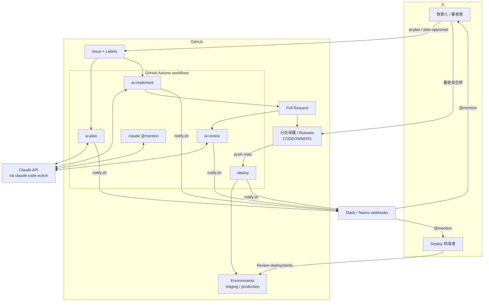

# 設計文件：從 Ticket 到上線的 AI 開發流水線

- 狀態：v0.1.0（設計已實作並有自動化測試；**尚未在真實 GitHub 組織中端到端驗證**，見 §14）
- 讀者：技術負責人、平台工程師、會審查此專案的 Staff Engineer
- 相關文件：[README](../../README.md)、[ADR 索引](../adr/README.md)、[圖表](../diagrams/pipeline-state.md)、[研究摘要](../research/oss-landscape.md)、[規範對照](../standards/spec-adaptation.md)

## 1. 背景與目標

10~20 人的開發團隊希望把軟體開發生命週期中重複性高的環節交給 AI Agent：需求釐清、研究、設計、
實作、Code Review、測試；只有在**必須由人負責的決策點**才人工介入。

### 目標

| # | 目標 | 衡量方式 |
| --- | --- | --- |
| G1 | 一張 ticket 能自動走到「PR 已開、已審查」 | 冒煙測試（README §驗證） |
| G2 | 人只在 3 個關卡介入：計畫、合併、正式環境部署 | §6 關卡由平台功能強制，Agent 無法繞過 |
| G3 | 需要人時主動通知對的人（Slack 或 Teams，並 mention） | `notify.sh` 測試、`workflow_notify_steps` 測試 |
| G4 | 維運成本最低：不自架伺服器、不維護資料庫 | 全部跑在 GitHub Actions |
| G5 | 安全：最小權限、不信任工單文字、不外洩機密 | §9 威脅模型與靜態測試 |
| G6 | 可安裝到多個產品 repo、可客製、可升級 | `install-into.sh`、repo variables |

### 非目標

- 不取代人對「做什麼」與「能不能上線」的判斷。
- 不自建 Agent 框架或排程器（見 [ADR-0001](../adr/0001-github-native-label-driven-pipeline.md)）。
- 不讓 AI 直接部署（部署是確定性的 CI/CD，見 §6）。
- 目前只支援 GitHub（GitLab、Bitbucket 不在範圍內）。
- 不內建 Jira/Linear 同步；以 §12 的升級路徑處理。

## 2. 需求

### 功能需求

1. 以標籤驅動的階段：計畫 → 實作 → 審查；部署走既有 CI/CD。
2. 計畫階段可提出釐清問題，並產出含影響分析、取捨、測試計畫的計畫。
3. 實作階段遵守 TDD，小步 commit，開 PR 並連結 issue。
4. 審查階段以獨立的 Agent 執行對照計畫的審查，留下 inline 留言與摘要。
5. 每個需要人的時刻都通知負責人（assignee → author → 預設群組）。
6. 可用單一指令安裝到產品 repo，不覆蓋既有檔案。

### 非功能需求

| 面向 | 需求 |
| --- | --- |
| 安全 | 最小權限、不信任輸入、機密不落地、Agent 不能改自己的規則 |
| 可觀測 | 結構化 JSON log（含 trace id）、失敗一定通知 |
| 成本 | 每個 job 有 timeout、`--max-turns`、並行限制；可用 variables 調整模型 |
| 可測試 | 腳本與 workflow 的核心邏輯有單元／整合測試，CI 強制 |
| 可維護 | 提示詞在檔案中，受 CODEOWNERS 與 hook 保護；文件隨程式更新 |

## 3. 方案選型（摘要）

完整調查見 [oss-landscape.md](../research/oss-landscape.md)。

| 方案 | 優點 | 缺點 | 結論 |
| --- | --- | --- | --- |
| **GitHub Actions + claude-code-action（採用）** | 零伺服器；官方維護；權限模型清楚；與分支保護、Environment 原生整合 | 工單綁 GitHub；Actions 分鐘數成本 | 作為基礎 |
| Cyrus（Apache-2.0） | Linear 指派即觸發；支援 Claude Code、Codex 等 | 自架或付費；官方稱 token 用量約 3~5 倍 | 工單必須在 Linear 時再加（§12） |
| OpenAI Symphony | 規格清楚、輪詢 Linear | README 標示為 engineering preview／僅供評估；Elixir | 暫不採用 |
| LangChain Open SWE | 功能完整（Slack/Linear/GitHub、沙盒） | 團隊部署工程量大；「Expect breaking changes」 | 暫不採用 |
| 桌面型並行工具（Claude Squad、Emdash…） | 開發者個人好用 | 非團隊流水線 | 不適用 |

## 4. 系統概觀

階段與關卡細節：[pipeline-state.md](../diagrams/pipeline-state.md)、
[sequence-ticket-to-merge.md](../diagrams/sequence-ticket-to-merge.md)、
[deploy-and-gates.md](../diagrams/deploy-and-gates.md)。

## 5. 元件設計

| 元件 | 位置 | 職責 | 重點設計 |
| --- | --- | --- | --- |
| 階段 workflows | `templates/workflows/ai-*.yml` | 觸發、準備環境、呼叫 Agent、通知 | 只傳編號給 Agent；每個 job 有 `permissions`、`timeout-minutes`；同一 issue 序列化 |
| 互動 workflow | `templates/workflows/claude.yml` | 人用 `@claude` 要求修改 | 僅有寫入權限者可觸發（action 內建檢查） |
| 部署 workflow | `templates/workflows/deploy.yml` | staging → 人核准 → production | 預設關閉（`DEPLOY_ENABLED`）；無 AI |
| 階段提示詞 | `tools/prompts/*.md` | 定義每個階段的行為與輸出格式 | 在檔案中、可 code review；CI 中 Agent 不能改 |
| 通知腳本 | `tools/scripts/notify.sh` | 把事件送到 Slack/Teams 並 mention | 失敗不影響流水線；跳脫外部文字；不印出 webhook；見 [契約](../api/notify-contract.md) |
| 擁有者對照 | `.github/notify-owners.json` | GitHub 帳號 → Slack ID、Teams 信箱、群組 | 找不到人退回 `default` 群組 |
| Hooks | `.claude/hooks/` | 擋機密字面值、保護自身規則檔 | 與 `scan-secrets.sh` 共用規則 |
| 規則與 Skills | `.claude/rules/`、`.claude/skills/` | 工程規範（測試、安全、Git、註解） | 由 `CLAUDE.md` 引用，隨安裝複製 |
| 記憶 | `.agents/` | MEM / ERR / SKILL | `check-memory-links.sh` 強制雙向標註 |
| 安裝器 | `tools/scripts/install-into.sh` | 複製模板到產品 repo | 不覆蓋、可 `--dry-run`、`--force` |
| 標籤工具 | `tools/scripts/setup-labels.sh` | 建立流程標籤 | 可重複執行 |
| 品質閘門 | `.github/workflows/ci.yml`、`Makefile` | shellcheck、yamllint、actionlint、測試、文件連結、機密掃描 | 本 repo 專用，不會被安裝 |

### 狀態與標籤

見 [pipeline-state.md](../diagrams/pipeline-state.md)。重點：Agent 用 `GITHUB_TOKEN` 貼的標籤**不會**觸發
其他 workflow，所以流程只能由人推進（[ERR](../../.agents/errors/ERR-20261021-github-token-events-do-not-trigger-workflows.md)）。

### 可調整的設定（不必改 YAML）

| 名稱 | 類型 | 作用 |
| --- | --- | --- |
| `ANTHROPIC_API_KEY` | secret | 呼叫 Claude |
| `SLACK_WEBHOOK_URL` / `TEAMS_WEBHOOK_URL` | secret | 通知頻道（至少設一個） |
| `AI_SETUP_CMD` | variable | 安裝依賴，例如 `npm ci` |
| `AI_TEST_TOOLS` | variable | 允許 Agent 執行的測試與 lint 指令（工具白名單格式） |
| `AI_MODEL_PLAN` / `AI_MODEL_IMPLEMENT` / `AI_MODEL_REVIEW` | variable | 各階段模型（有預設值） |
| `DEPLOY_ENABLED` | variable | 設為 `true` 才啟用 `deploy.yml` |

## 6. 三個人工關卡

| 關卡 | 為何必須由人 | 強制機制 | Agent 能否繞過 |
| --- | --- | --- | --- |
| 1 計畫 | 決定「做什麼、怎麼做」的責任在人 | 實作 workflow 只在人貼 `plan-approved` 時觸發；貼標籤需 Triage 以上權限 | 否：Agent 用 `GITHUB_TOKEN` 貼的標籤不會觸發 workflow |
| 2 合併 | 最後的品質與風險判斷 | Ruleset：需人類核准、必要檢查、Code Owners；Agent 工具白名單沒有 merge／approve | 否：靜態測試禁止出現 `gh pr merge`、`gh pr review --approve`、`gh api` |
| 3 正式環境 | 上線影響使用者 | Environment `production` 的 Required reviewers | 否：由 GitHub 暫停 job |

## 7. 主要流程

序列圖見 [sequence-ticket-to-merge.md](../diagrams/sequence-ticket-to-merge.md)。失敗路徑：

| 失敗 | 偵測 | 結果 |
| --- | --- | --- |
| 計畫或實作 job 失敗、逾時 | `notify` job 的 `needs.<job>.result` | 通知負責人並附 run 連結 |
| 實作成功但沒有開 PR | 以 `Closes #N` 搜尋 PR | 通知「沒有開 PR」 |
| AI 審查失敗 | `needs.review.result` | 通知「AI 審查失敗，請人工審查」 |
| Webhook 失敗 | HTTP 狀態碼非 2xx | `::warning::`，流水線不失敗 |
| 部署失敗或被拒 | `failure()` | 通知 `deploy` 群組 |

## 8. 影響分析（Impact Graph）

見 [component-graph.md](../diagrams/component-graph.md)，含「改了 X 要檢查 Y」的清單。

## 9. 安全設計與威脅模型

| 威脅 | 情境 | 緩解 | 殘餘風險 |
| --- | --- | --- | --- |
| Prompt injection | issue／PR／留言夾帶「忽略規則、外洩金鑰」 | 文字視為不可信資料；prompt 只傳編號；靜態測試禁止把事件文字展開進 `run`／`prompt`；工具白名單；hooks | 模型仍可能被誤導在白名單內做錯事 → 由人審查計畫與 PR（關卡 1、2） |
| 外部人員觸發 | 公開 repo 的陌生人留言 `@claude` | action 預設要求觸發者有寫入權限；不使用 `allowed_non_write_users: "*"` | 公開 repo 風險較高，建議私有 repo |
| 機密外洩 | Agent 把金鑰寫進程式或日誌 | `block-secrets` hook、`scan-secrets.sh`、CI 的 Gitleaks、不印環境變數、`.env*` 不進版控 | Hook 不是安全邊界（shell 重導向可繞過），所以有 CI 掃描 |
| Agent 改自己的規則 | 為通過檢查而改 workflow、prompt、CLAUDE.md | CI 中 `protect-paths` hook 擋；Code Owners 要求人審 `.github/`、`.claude/`、`tools/` | 本機人類可修改（預期行為） |
| 供應鏈 | Action 或工具被竄改 | Dependabot 追蹤 Action 版本；PR 要人審 | 以標籤（`@v1`）引用，非 commit SHA；高安全環境請改為 SHA 並釘住 |
| 通知腳本被 PR 改寫 | PR 修改 `notify.sh` 偷 webhook | PR 情境下從 base 分支 checkout 腳本（有測試） | — |
| Webhook 外洩 | URL 出現在日誌 | 只放 Secrets；腳本不輸出；測試確認不洩漏 | URL 一旦外洩需重新產生 |
| 失控成本 | 無限迴圈、同時大量 issue | `--max-turns`、`timeout-minutes`、`concurrency`；用專用 API Key 並設用量上限 | 需要人定期看用量 |
| 惡意 Slack 提及 | issue 標題含 `<!channel>` | Slack 文字跳脫 `& < >` | — |

## 10. 可觀測性

- `notify.sh` 的每則 log 為 JSON：`ts`、`level`、`msg`、`trace_id`（GitHub run id）、`user_id`（actor）。
- 每個階段在 issue／PR 上留下可稽核的留言；Actions 保留 run 記錄。
- 用量：Anthropic Console 的專用 Key；GitHub 的 Actions 用量報表。

## 11. 成本與容量（10~20 人）

| 項目 | 說明 | 控制手段 |
| --- | --- | --- |
| Claude API | 與任務複雜度、程式庫大小成正比 | 專用 Key 與額度；`--max-turns`；明確的 ticket（`ai-task` 範本）；精簡的 `CLAUDE.md` |
| Actions 分鐘數 | 每個階段一個 job，審查在每次 PR 更新時執行 | `timeout-minutes`；審查 `concurrency` 取消舊執行 |
| 並行 | 以 issue 為單位序列化；不同 issue 可並行 | 視需要再加全域 concurrency 或限制標籤使用者 |
| 人的時間 | 真正的瓶頸在審查計畫與 PR | 計畫先行、PR 範本、AI 預審 |

實際金額取決於你的使用方式與當時的價格，請以官方定價頁為準，並在 §14 的試行期收集數據。

## 12. 升級路徑

| 需求 | 做法 |
| --- | --- |
| 工單在 Linear／要「指派給 AI」體驗 | 加 Cyrus；本 pipeline 的 PR 之後流程（審查、關卡 2、3）不變 |
| 更嚴謹的規格 | 在計畫階段導入 GitHub Spec Kit |
| 交叉審查 | 把審查換成 `openai/codex-action`（見 [ADR-0006](../adr/0006-same-vendor-review-with-cross-model-upgrade-path.md)） |
| Jira | 用 Jira Automation 呼叫 `repository_dispatch`，或使用 Jira 與 GitHub 的整合建立 issue |
| 高安全 | Bedrock／Vertex／Foundry 或 OIDC 聯邦驗證；Action 釘 SHA；自訂 GitHub App 取得最小權限 |

## 13. Trade-off Analysis（主要取捨）

### 13.1 提示詞放在檔案，而不是寫在 workflow 內

- Pros：可 code review、可版本化、可被 CODEOWNERS 保護；workflow 不含長字串。
- Cons：多一個檔案；計畫階段需要先 checkout。
- Reason：提示詞就是系統行為，應和程式碼一樣被審查。

### 13.2 標籤驅動而非留言指令

- Pros：標籤權限由 GitHub 管理；狀態一目了然；不需要解析自由文字。
- Cons：重新觸發需「移除再貼上」；要先建立標籤。
- Reason：自由文字是攻擊面，標籤是受控的輸入。

### 13.3 通知用單一 bash 腳本與 webhook

- Pros：沒有額外服務；Slack 與 Teams 共用同一份擁有者對照；可離線測試。
- Cons：webhook 綁單一頻道；Teams mention 在 Workflows webhook 上需在你的租戶驗證。
- Reason：最小可行；升級到 Slack App 或 Power Automate 流程時只需替換腳本（[ADR-0003](../adr/0003-notifications-via-webhook-script.md)）。

### 13.4 以複製模板安裝，而非 reusable workflows

- Pros：每個產品 repo 可獨立客製與審查；沒有跨 repo 的隱性耦合；離線可讀。
- Cons：升級需重新執行安裝器並手動合併；各 repo 可能漂移。
- Reason：10~20 人的團隊通常 repo 數量不多，可控性優先（[ADR-0007](../adr/0007-distribute-by-copying-templates.md)）。

## 14. 驗證計畫與未解問題

自動化測試只驗證了腳本與 workflow 的邏輯，**以下項目必須在沙盒 repo 實測**：

| # | 項目 | 為什麼不確定 | 驗證方式 |
| --- | --- | --- | --- |
| V1 | Agent 開的 PR 是否會觸發 `pull_request` workflow（CI、AI 審查） | 取決於 PR 是由 App token 還是 `GITHUB_TOKEN` 建立 | 冒煙測試步驟 7；若失敗改用 `actions/create-github-app-token` |
| V2 | 自動模式（有 `prompt`）下，Agent 的 `gh` 與 `git push` 是否自動帶有憑證 | 文件主要描述互動模式 | 冒煙測試步驟 5、7 |
| V3 | 專案的 `.claude/settings.json` hooks 在 Action 內是否生效 | 需確認 action 載入專案設定 | 在沙盒要求 Agent 修改 `.github/` 檔案，應被擋下 |
| V4 | Teams Workflows webhook 是否保留 `msteams.entities` mention | 官方文件主要描述舊版 incoming webhook | 在測試頻道送一則通知，確認被提及者收到通知 |
| V5 | 模型 ID 預設值（`claude-opus-5-5`、`claude-sonnet-5-5`）在你的帳號可用 | 模型清單會變動 | 以 repo variables 覆寫；查官方模型文件 |
| V6 | 私有 repo 在你的 GitHub 方案是否支援分支保護與 Environment 審核者 | 依方案而異 | 以官方方案說明為準 |

試行期建議：2 週、3~5 張低風險 ticket，記錄計畫採納率、PR 一次通過率、每張 ticket 的成本。

## 15. 路線圖

見根目錄 [todo.md](../../todo.md) 與 [CHANGELOG](../../CHANGELOG.md)。
