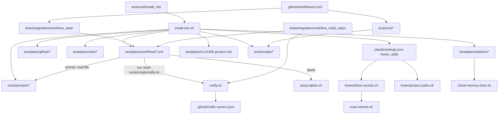

# Diagram: component dependency graph (impact analysis)

Use this before changing anything: an arrow `A --> B` means "A depends on B", so a change to B
may break A (upstream impact) and a change to A may need B to be updated (downstream).

## Impact checklist

| If you change | Also check |
| --- | --- |
| A label name | `setup-labels.sh` + test, workflow `if:` conditions, prompts, `pipeline-state.md`, README |
| `notify.sh` interface | every `notify` job, [notify-contract.md](../api/notify-contract.md), tests |
| A workflow template | `workflows_static`, `workflow_notify_steps`, `install_into` tests; DESIGN.md |
| A prompt | the workflow that names it, `protect-paths.sh` (it is protected in CI), review prompt consistency |
| `.claude/settings.json` | installer copies it to product repos; hooks tests |
