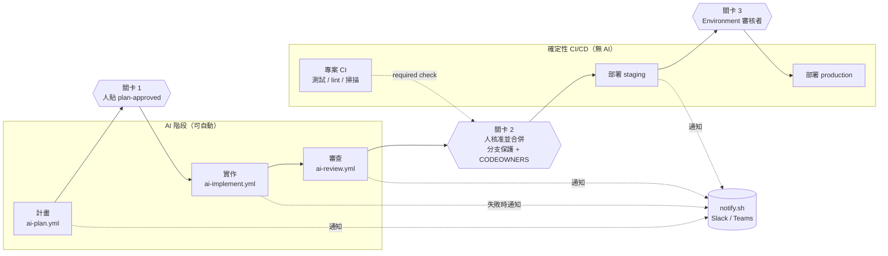

# Diagram: human gates and deployment

The three diamonds are the only places where the pipeline waits for a person. They are enforced
by GitHub features (label permissions, rulesets, environment reviewers), so an agent that
misbehaves cannot skip them. See
[MEM-0002](../../.agents/memories/MEM-0002-three-human-gates.md).
