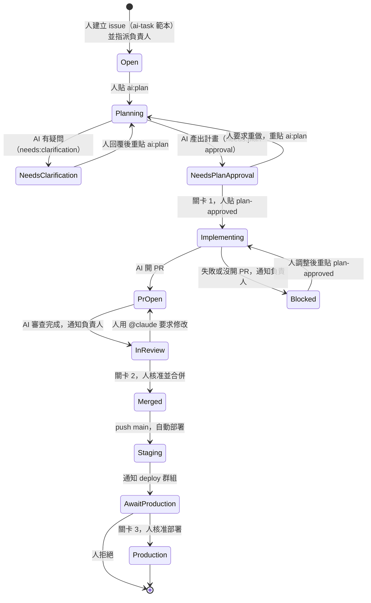

# Diagram: ticket state machine

Source of truth for label semantics (see
[MEM-0001](../../.agents/memories/MEM-0001-label-driven-github-native-pipeline.md)). Update this
file whenever a label, trigger or gate changes.

## Label reference

| Label | Set by | Meaning | Removed by |
| --- | --- | --- | --- |
| `ai:plan` | Human | Start (or restart) stage 1 | The plan agent consumes it when done |
| `needs:clarification` | Plan agent | Questions waiting for the human | Plan agent at the next round |
| `needs:plan-approval` | Plan agent | Plan is ready for gate 1 | Plan agent at the next round |
| `plan-approved` | Human | Gate 1 passed: implement | Human removes it to re-run stage 2 (remove, then add again) |

A workflow starts only when a label is *added*. To re-run a stage, remove the label and add it
again.
