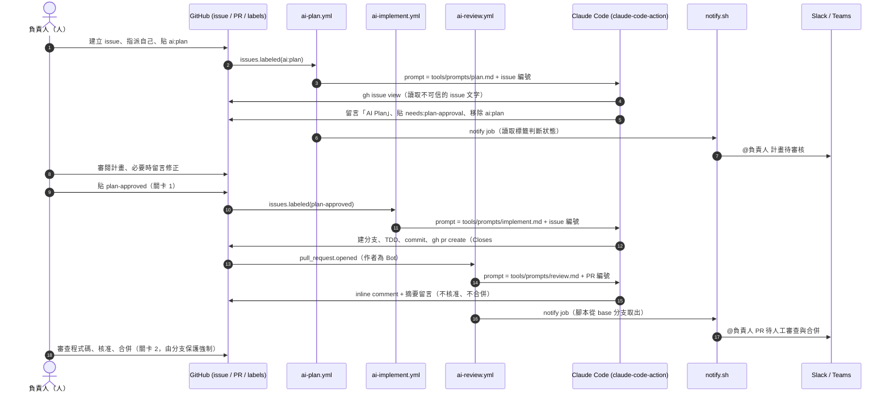

# Diagram: from ticket to merged pull request

Failure paths: if `plan` or `implement` fails, their `notify` job still runs (`if: always()`)
and sends a failure message with the run link. A successful implementation stays silent because
the review workflow announces the PR.
